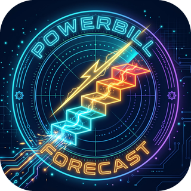
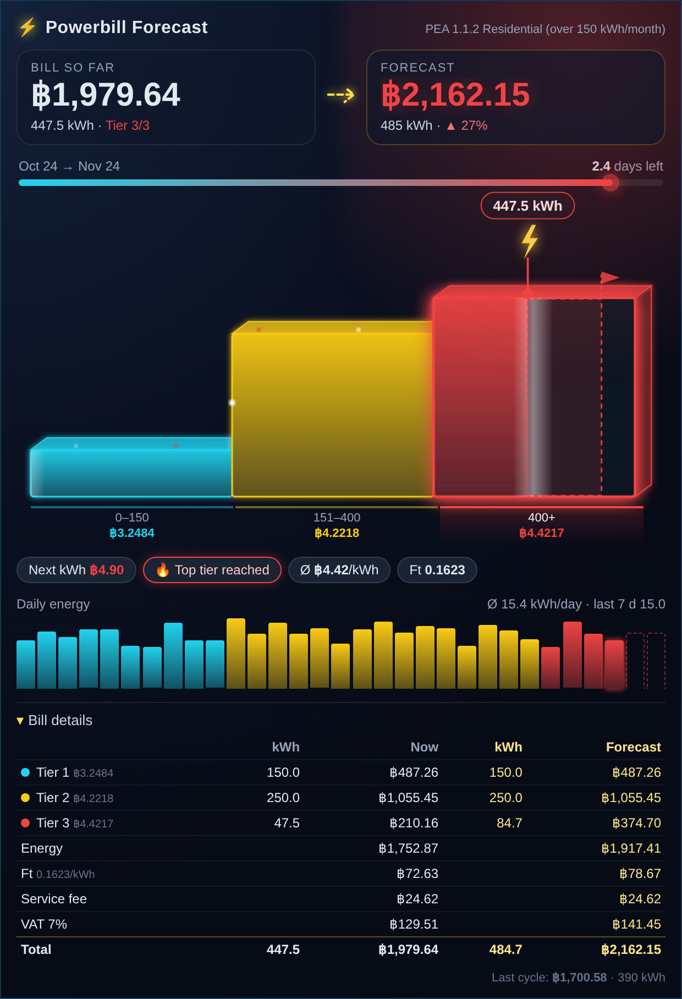

<p align="center">
  
</p>

<h1 align="center">⚡ Powerbill Forecast</h1>

<p align="center">
  <b>Tiered tariff energy costs and a month-end bill forecast for Home Assistant.</b><br>
  Watch your consumption climb the price staircase - and know your bill before it arrives.
</p>

<p align="center">
  <a href="https://github.com/hacs/integration"></a>
  
  
  <a href="https://ko-fi.com/mb26dev"></a>
</p>

---

## 📸 Screenshots

<p align="center">
  
</p>
<p align="center">
  
  
</p>

---

## 🤔 Why

Many utilities do not charge one price per kWh. They charge **progressive tiers**: the first 150 kWh are cheap, the next 250 kWh cost more, and everything above 400 kWh costs the most. On top come surcharges like Thailand's **Ft**, a monthly service fee and VAT.

The Home Assistant energy dashboard only knows a single price, so the cost it shows is wrong for these tariffs, and it never tells you where the month will end. Powerbill Forecast does the real tier maths and adds the forecast:

- 💰 **Live bill** for the running billing cycle, exactly as the utility calculates it
- 🔮 **Month-end forecast** of energy, tier and bill
- 🪜 **Tier tracking**: current tier, kWh left before the next, more expensive tier and the days until you get there
- 🏷️ **Price of the next kWh** including surcharge and VAT - the number that matters when you switch on the air conditioning
- 📉 **Comparison with the last cycle**

## ✨ Highlights

### 🪜 Animated tier staircase
Every tier is a glowing step. The height follows the price, the steps fill up with energy as you use it, particles climb to your current position and the dashed ghost shows where the forecast will take you.

### 🔮 Forecast that reacts to your behaviour
The daily rate blends the average of the running cycle with the **last 7 days** (air conditioning season shows up immediately). Right after the cycle starts, the previous cycle fills the gap until there is enough data.

### 📊 Daily energy bars
One bar per day of the cycle, coloured by the tier the cumulative consumption reached that day. Dashed bars show the forecast for the remaining days.

### 🧾 Bill details
Tier by tier, surcharge, service fee and VAT - now and at the end of the cycle, side by side.

### 🌏 Any tiered tariff
Presets for **PEA** and **MEA** (Thailand) are built in. For any other utility, enter your own tiers in one line.

---

## 📦 Installation

### HACS (recommended)
1. HACS → ⋮ → **Custom repositories** → add `https://github.com/mb26-dev/ha-powerbill-forecast` as **Integration**
2. Install **Powerbill Forecast** and restart Home Assistant
3. **Settings → Devices & services → Add integration → Powerbill Forecast**

### Manual
Copy `custom_components/powerbill_forecast` into your `config/custom_components` folder and restart.

The dashboard card is registered automatically - no resource to add.

---

## ⚙️ Configuration

| Field | Description |
|---|---|
| **Energy meter** | A kWh sensor. Either a **utility meter that resets every billing cycle**, or a **total meter** that only counts up. |
| **Meter type** | `Resets every billing cycle` or `Counts up forever`. For total meters the start of the cycle is taken from the long-term statistics. |
| **Billing cycle starts on day** | The day the utility reads your meter (printed on the bill). |
| **Tariff** | A preset or `Custom tariff`. |
| **Custom tiers** | `150=3.2484, 400=4.2218, *=4.4217` - upper kWh of the tier = price, `*` = everything above. A flat price is just `0.31`. |
| **Monthly service fee / VAT / Currency** | Leave empty to use the values of the preset. |
| **Fuel adjustment (Ft)** | A fixed surcharge per kWh, or a sensor that provides it (wins over the fixed value). |

Everything can be changed later under **Configure**.

### 🇹🇭 Thailand presets

| Preset | Tiers (THB/kWh) | Service fee |
|---|---|---|
| PEA / MEA 1.1.1 (up to 150 kWh/month) | 0-15: 2.3488 · 16-25: 2.9882 · 26-35: 3.2405 · 36-100: 3.6237 · 101-150: 3.7171 · 151-400: 4.2218 · 401+: 4.4217 | 8.19 |
| PEA / MEA 1.1.2 (over 150 kWh/month) | 0-150: 3.2484 · 151-400: 4.2218 · 401+: 4.4217 | 24.62 |

VAT 7 % is applied to energy, Ft and service fee. The Ft changes every few months - point **Fuel adjustment (Ft) from entity** to a sensor that scrapes the current value from the PEA website, or update the fixed value when it changes.

---

## 📈 Sensors

| Entity | Description |
|---|---|
| `sensor.powerbill_forecast_forecast_bill` | Bill expected at the end of the cycle (the card reads this one) |
| `sensor.powerbill_forecast_current_bill` | Bill for the energy used so far |
| `sensor.powerbill_forecast_previous_cycle_bill` | Last cycle, calculated with today's tariff |
| `sensor.powerbill_forecast_cycle_energy` | kWh in the running cycle |
| `sensor.powerbill_forecast_forecast_energy` | kWh expected at the end of the cycle |
| `sensor.powerbill_forecast_current_tier` | Current tier (1 = cheapest) |
| `sensor.powerbill_forecast_energy_to_next_tier` | kWh left before the next tier, with `days_to_next_tier` |
| `sensor.powerbill_forecast_price_of_next_kwh` | Rate + Ft + VAT of the next kWh |
| `sensor.powerbill_forecast_average_price` | Total bill / kWh |
| `sensor.powerbill_forecast_days_left_in_cycle` | Days until the meter reading |

The entity IDs follow the name you give the integration.

---

## 🖼️ Card

```yaml
type: custom:powerbill-forecast-card
entity: sensor.powerbill_forecast_forecast_bill
```

| Option | Default | Description |
|---|---|---|
| `entity` | auto | The **Forecast bill** sensor. Found automatically if you have only one. |
| `title` | `Powerbill Forecast` | Card title |
| `show_chips` | `true` | Price of the next kWh, distance to the next tier, average price, Ft |
| `show_daily` | `true` | Daily energy bars |
| `show_breakdown` | `true` | Collapsible bill details |
| `animate` | `true` | Count-up animation of the amounts |

The card works on phones and wall tablets and respects *reduce motion*.

---

## 💡 Automation ideas

```yaml
alias: Warn before the next electricity tier
triggers:
  - trigger: numeric_state
    entity_id: sensor.powerbill_forecast_energy_to_next_tier
    below: 20
actions:
  - action: notify.notify
    data:
      message: >
        Only {{ states('sensor.powerbill_forecast_energy_to_next_tier') }} kWh left
        before the next tier - the next kWh will cost
        {{ state_attr('sensor.powerbill_forecast_energy_to_next_tier', 'next_rate') }} per kWh plus Ft and VAT.
```

---

## ℹ️ Good to know

- The forecast is an estimate. The utility's own reading and rounding decide the final bill.
- Thai tariff 1.1.1 applies only while you stay at or below 150 kWh per month; pick the preset that is printed on your bill.
- Energy in Wh or MWh is converted to kWh automatically.

## 🙏 Support

If Powerbill Forecast helps you keep the bill down, a coffee keeps the next project going: [ko-fi.com/mb26dev](https://ko-fi.com/mb26dev)

## 📄 License

MIT
