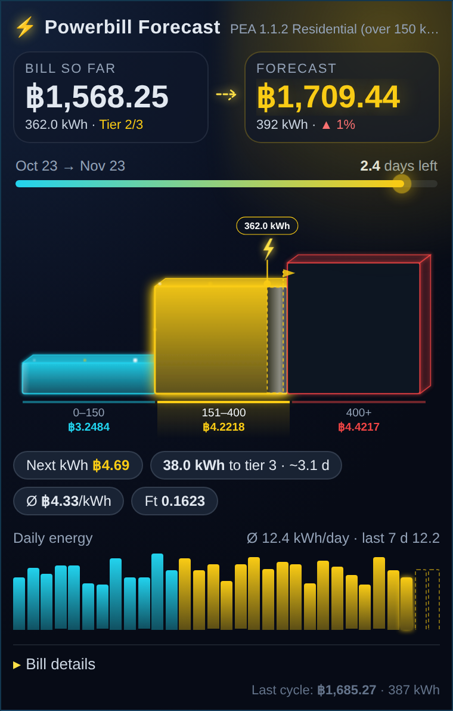
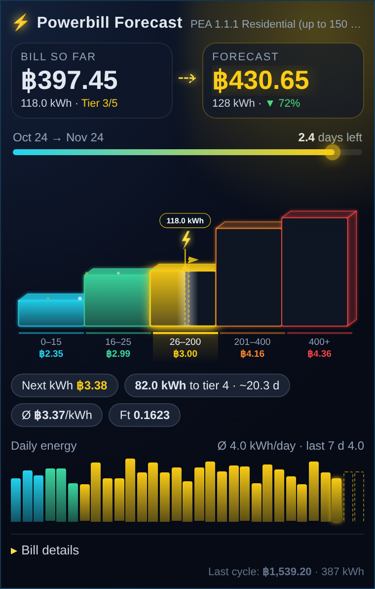
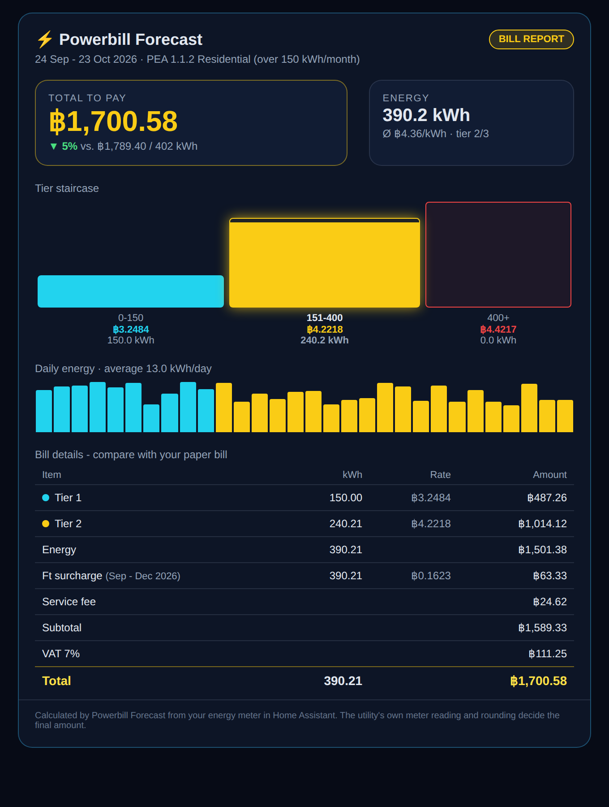

<p align="center">
  
</p>

<h1 align="center">⚡ Powerbill Forecast</h1>

<p align="center">
  <b>Tiered tariff energy costs and a month-end bill forecast for Home Assistant.</b><br>
  Watch your consumption climb the price staircase - and know your bill before it arrives.
</p>

<p align="center">
  <a href="https://my.home-assistant.io/redirect/hacs_repository/?owner=mb26-dev&repository=ha-powerbill-forecast&category=integration"></a>
  <a href="https://github.com/mb26-dev/ha-powerbill-forecast/releases"></a>
  
  <a href="LICENSE"></a>
  <a href="https://ko-fi.com/mb26dev"></a>
</p>

---

## 📸 Screenshots

<p align="center">
  
</p>
<p align="center">
  
  
</p>

---

## 🤔 Why

Many utilities do not charge one price per kWh. They charge **progressive tiers**: the first 150 kWh are cheap, the next 250 kWh cost more, and everything above 400 kWh costs the most. On top come surcharges like Thailand's **Ft**, a monthly service fee and VAT.

The Home Assistant energy dashboard only knows a single price, so the cost it shows is wrong for these tariffs, and it never tells you where the month will end. Powerbill Forecast does the real tier maths and adds the forecast:

- 💰 **Live bill** for the running billing cycle, exactly as the utility calculates it
- 🔮 **Month-end forecast** of energy, tier and bill
- 🪜 **Tier tracking**: current tier, kWh left before the next, more expensive tier and the days until you get there
- 🏷️ **Price of the next kWh** including surcharge and VAT - the number that matters when you switch on the air conditioning
- ⛽ **Ft surcharge fetched automatically** from the official PEA website - the bill stays right when the Ft changes
- 📧 **Monthly bill report** in the same design, ready to compare with the paper bill
- 📉 **Comparison with the last cycle**

## ✨ Highlights

### 🪜 Animated tier staircase
Every tier is a glowing step. The height follows the price, the steps fill up with energy as you use it, particles climb to your current position and the dashed ghost shows where the forecast will take you.

### 🔮 Forecast that reacts to your behaviour
The daily rate blends the average of the running cycle with the **last 7 days** (air conditioning season shows up immediately). Right after the cycle starts, the previous cycle fills the gap until there is enough data.

### 📊 Daily energy bars
One bar per day of the cycle, coloured by the tier the cumulative consumption reached that day. Dashed bars show the forecast for the remaining days.

### 🧾 Bill details
Tier by tier, surcharge, service fee and VAT - now and at the end of the cycle, side by side.

### ⛽ Ft straight from PEA
Thailand's fuel adjustment charge (Ft) changes every four months (January, May, September). Powerbill Forecast reads the current value from the [official PEA Ft page](https://www.pea.co.th/en/our-services/tariff/ft) twice a day - the same Ft applies to PEA and MEA. When it changes, the bill and the forecast follow immediately and the event `powerbill_forecast_ft_changed` fires. If the page cannot be reached, the last known value stays in use.

### 📧 Monthly bill report
When the meter is read, the finished cycle is frozen as **your bill**: tiers, Ft, service fee and VAT - exactly the lines of the paper bill. The included blueprint sends it as an e-mail laid out like a paper electricity bill (bill period, meter reading date, charges in the usual order, total amount and a six-month usage history), so you can check it line by line:

<p align="center">
  
</p>

### 🌏 Any tiered tariff
Presets for **PEA** and **MEA** (Thailand) are built in. For any other utility, enter your own tiers in one line.

---

## 📦 Installation

### HACS / Home Assistant Marketplace (recommended)
Powerbill Forecast is part of the default HACS repository list - just search for it.

[](https://my.home-assistant.io/redirect/hacs_repository/?owner=mb26-dev&repository=ha-powerbill-forecast&category=integration)

1. Click the button above, or open HACS (**Settings → Marketplace** on Home Assistant 2026.11+) and search for **Powerbill Forecast**
2. Install it and restart Home Assistant
3. **Settings → Devices & services → Add integration → Powerbill Forecast**

If you added this repository as a custom repository before, you can remove that entry; the installed integration and its settings stay as they are.

### HACS custom repository (fallback)
If your HACS does not list it yet: HACS → ⋮ → **Custom repositories** → add `https://github.com/mb26-dev/ha-powerbill-forecast` as **Integration**, then install as above.

### Manual
Copy `custom_components/powerbill_forecast` into your `config/custom_components` folder and restart.

The dashboard card is registered automatically - no resource to add.

---

## ⚙️ Configuration

| Field | Description |
|---|---|
| **Energy meter** | A kWh sensor. Either a **utility meter that resets every billing cycle**, or a **total meter** that only counts up. |
| **Meter type** | `Resets every billing cycle` or `Counts up forever`. For total meters the start of the cycle is taken from the long-term statistics. |
| **Billing cycle starts on day** | The day the utility reads your meter (printed on the bill). |
| **Tariff** | A preset or `Custom tariff`. |
| **Custom tiers** | `150=3.2484, 400=4.2218, *=4.4217` - upper kWh of the tier = price, `*` = everything above. A flat price is just `0.31`. |
| **Monthly service fee / VAT / Currency** | Leave empty to use the values of the preset. |
| **Fuel adjustment (Ft) source** | `Official PEA website` (Thailand, automatic), `Entity` (any sensor) or `Fixed value` (0 if your utility has no surcharge). |
| **Ft entity / fixed value** | Only for the matching source. The fixed value is also the fallback until the first download. |

Everything can be changed later under **Configure**.

### 🇹🇭 Thailand presets

| Preset | Tiers (THB/kWh) | Service fee |
|---|---|---|
| PEA 1.1.1 / MEA 1.1 (up to 150 kWh/month) | 1-15: 2.3488 · 16-25: 2.9882 · 26-200: 3.0000 · 201-400: 4.1584 · 401+: 4.3583 | 8.19 |
| PEA 1.1.2 / MEA 1.2 (over 150 kWh/month) | 1-200: 3.0000 · 201-400: 4.1584 · 401+: 4.3583 | 24.62 |

Rates valid from the September 2026 bills. VAT 7 % is applied to energy, Ft and service fee. Choose **Official PEA website** as Ft source and the Ft is always current.

---

## 📈 Sensors

| Entity | Description |
|---|---|
| `sensor.powerbill_forecast_forecast_bill` | Bill expected at the end of the cycle (the card reads this one) |
| `sensor.powerbill_forecast_current_bill` | Bill for the energy used so far |
| `sensor.powerbill_forecast_previous_cycle_bill` | Last finished cycle, frozen as the bill (tiers, Ft, fee, VAT) |
| `sensor.powerbill_forecast_cycle_energy` | kWh in the running cycle |
| `sensor.powerbill_forecast_forecast_energy` | kWh expected at the end of the cycle |
| `sensor.powerbill_forecast_current_tier` | Current tier (1 = cheapest) |
| `sensor.powerbill_forecast_energy_to_next_tier` | kWh left before the next tier, with `days_to_next_tier` |
| `sensor.powerbill_forecast_price_of_next_kwh` | Rate + Ft + VAT of the next kWh |
| `sensor.powerbill_forecast_average_price` | Total bill / kWh |
| `sensor.powerbill_forecast_days_left_in_cycle` | Days until the meter reading |
| `sensor.powerbill_forecast_ft_surcharge` | Ft in use, with `period`, `source` and the last download |
| `button.powerbill_forecast_meter_read_now` | Closes the bill at this moment (the meter reader has been) |

The entity IDs follow the name you give the integration.

---

## 🖼️ Card

```yaml
type: custom:powerbill-forecast-card
entity: sensor.powerbill_forecast_forecast_bill
```

| Option | Default | Description |
|---|---|---|
| `entity` | auto | The **Forecast bill** sensor. Found automatically if you have only one. |
| `title` | `Powerbill Forecast` | Card title |
| `show_chips` | `true` | Price of the next kWh, distance to the next tier, average price, Ft |
| `show_daily` | `true` | Daily energy bars |
| `show_breakdown` | `true` | Collapsible bill details |
| `animate` | `true` | Count-up animation of the amounts |

The card works on phones and wall tablets and respects *reduce motion*.

---

## 📧 Bill report

### Blueprint
[](https://my.home-assistant.io/redirect/blueprint_import/?blueprint_url=https%3A%2F%2Fgithub.com%2Fmb26-dev%2Fha-powerbill-forecast%2Fblob%2Fmain%2Fblueprints%2Fautomation%2Fpowerbill_forecast%2Fmonthly_bill_report.yaml)

The automation sends the report when a cycle closes - at the send time if that happens at night, right away after a recorded meter reading, and safe across restarts - and runs your send actions with the variables `report_subject`, `report_html`, `report_text`, `report_total` and `report_kwh`. Example for an SMTP e-mail:

```yaml
action: notify.send_message
target:
  entity_id: notify.my_mailbox
data:
  title: "{{ report_subject }}"
  message: "{{ report_text }}"
```

For HTML mail use the action of your mail integration with `html: "{{ report_html }}"`.

### 🧮 Match the paper bill exactly
The utility does not read the meter at midnight. To end the cycle at the real reading, record it - the bill is then closed right away and the report is sent:

- press **Meter read now** (button entity) when the meter reader has been, or
- use the action with the date and time printed on the bill - optionally with the consumption from the bill, which is then compared with your Home Assistant meter:

```yaml
action: powerbill_forecast.meter_reading
data:
  reading_time: "2026-11-23 12:20:00"
  consumption: 473
```

The next cycle continues exactly at this reading. Without a recorded reading the cycle closes automatically on the configured day. Every line of the bill is rounded to satang before it is added up, the same way PEA prints it.

### Action `powerbill_forecast.build_report`
Returns `subject`, `html`, `text`, `total` and `kwh`. `cycle: previous` is the finished bill, `cycle: current` the running cycle with forecast - handy to try the design right away:

```yaml
action: powerbill_forecast.build_report
data:
  cycle: current
response_variable: report
```

### Events
| Event | When |
|---|---|
| `powerbill_forecast_cycle_closed` | A billing cycle has finished (about 2 hours after the meter reading day starts, or when a meter reading is recorded) |
| `powerbill_forecast_ft_changed` | PEA published a new Ft (`old`, `new`, `period`) |

---

## 💡 Automation ideas

```yaml
alias: Warn before the next electricity tier
triggers:
  - trigger: numeric_state
    entity_id: sensor.powerbill_forecast_energy_to_next_tier
    below: 20
actions:
  - action: notify.notify
    data:
      message: >
        Only {{ states('sensor.powerbill_forecast_energy_to_next_tier') }} kWh left
        before the next tier - the next kWh will cost
        {{ state_attr('sensor.powerbill_forecast_energy_to_next_tier', 'next_rate') }} per kWh plus Ft and VAT.
```

---

## ℹ️ Good to know

- The forecast is an estimate. The utility's own reading and rounding decide the final bill.
- Thai tariff 1.1.1 applies only while you stay at or below 150 kWh per month; pick the preset that is printed on your bill.
- Energy in Wh or MWh is converted to kWh automatically.
- The first finished cycle after the installation is stored quietly; reports start with the next meter reading.

## 🙏 Support

If Powerbill Forecast helps you keep the bill down, a coffee keeps the next project going: [ko-fi.com/mb26dev](https://ko-fi.com/mb26dev)

## 📄 License

MIT
